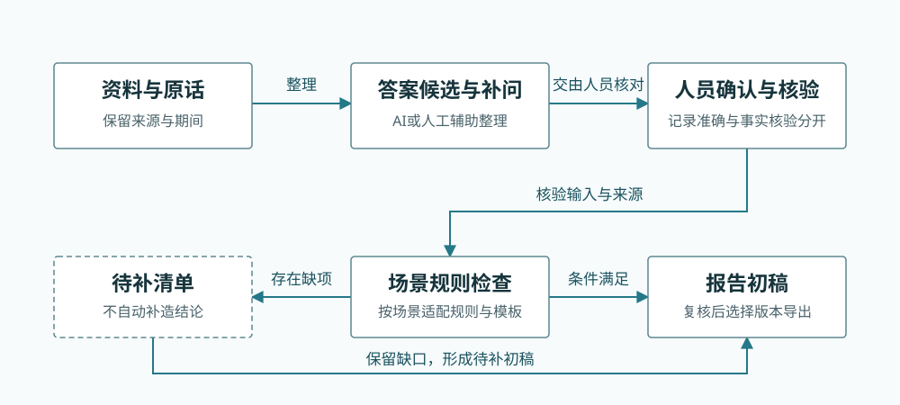
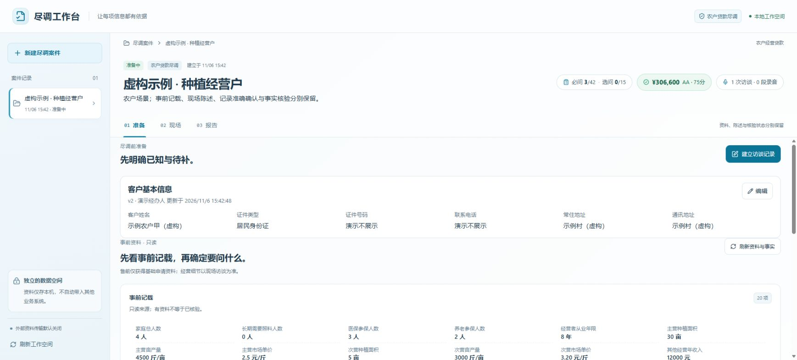
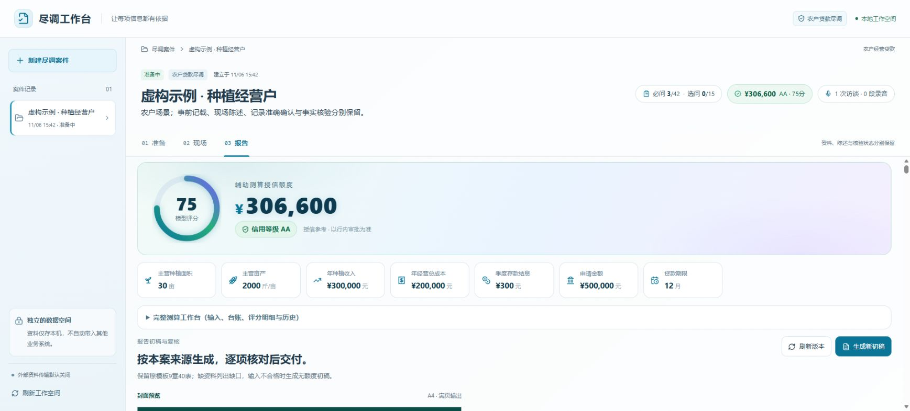
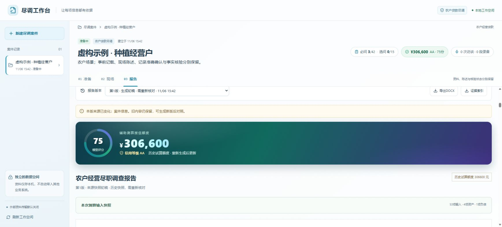

# 问询工作台

**面向各类问询与访谈，把资料准备、问题设计、现场记录、答案整理和报告输出连成一条可追溯的工作流程。**

无论是客户访谈、需求调研、服务回访，还是尽职调查与内部核查，只要需要围绕问题收集信息、核对依据并形成文档，都可以借鉴这套流程。AI辅助整理原话和发现待问内容，人员决定采纳什么、核验什么、交付什么。

[了解操作示例](docs/DEMO.md) · [阅读开发说明](docs/DEVELOPMENT.md) · [离线流程图解](docs/overview.html)

## 从一次问询到一份可复核的记录



1. **准备**：梳理背景资料，明确本次需要回答的问题与已有信息缺口。
2. **问询**：围绕问题记录回答；具备语音环境时，可录音或导入音频并转写，借助AI整理答案候选和补问建议。
3. **核对**：由人员确认原话、答案、来源与时间范围；按场景规则检查缺项和冲突，需要测算的场景再使用对应规则。
4. **成文**：生成带来源与待补项的记录或报告初稿，人工复核后选择版本导出。

资料、原话、答案、核验记录和报告版本保持关联。“有记录”“已作答”“记录准确”“事实已核验”分别处理，信息不足时保留待补状态。

## 围绕共同工作组织功能

- **资料与问题**：集中查看背景记载、问题目录、回答进度和待补内容。
- **记录与整理**：保留访谈原话、结构化答案、AI候选和补问建议，由人员采纳或修改。
- **来源与核验**：记录信息来自哪里、覆盖什么期间、经过哪些确认，保留修改历史与冲突。
- **场景规则**：结合具体业务检查条件；需要计算时，另行记录输入、规则版本和计算轨迹。
- **文档与版本**：生成带依据的初稿、补充人工说明，保留历史版本，并导出DOCX与证据JSON。
- **本地资料管理**：使用独立数据目录，提供备份验证、恢复与删除流程。

## 可以延展到哪些问询场景

- **客户访谈**：整理现状、诉求、约束与待跟进事项，形成沟通记录。
- **需求调研**：围绕调研提纲收集原话，将问题、回答和依据放在一起。
- **服务回访**：核对反馈内容、处理进展和仍需补问的信息。
- **尽职调查与内部核查**：按问题目录整理材料、核对差异并生成审阅初稿。

这些场景共用“提问—记录—核对—成文”的思路。当前仓库的具体界面与规则以农户尽调为示例，应用到其他场景时，需要适配问题目录、字段、核查规则和报告模板。

## 现有场景示例：农户尽调

以下为当前应用的实际界面，展示通用流程如何落到一个具体场景。人物、资料和金额均为虚构示例，证件号、电话和详细地址使用占位文字。

**准备资料，识别待补内容。**



**查看场景规则结果，再生成报告。** 该示例含独立的辅助测算模块；其他问询场景可按自身需求设计规则。



**修改信息后，重新核对依赖它的报告。** 历史内容与原版仍可查看。



事前资料、问卷答案与测算输入是不同的数据层，示例未将它们自动合并为同一口径。具体操作与截图说明见[演示指南](docs/DEMO.md)。

## AI、规则与人员怎样配合

**AI提供候选，规则检查条件，人员确认与核验。**

AI帮助整理语言、定位相关原话和发现待问内容；规则按明确输入执行检查或计算；人员处理歧义、确认答案、核验依据并复核输出。采纳AI建议不会自动完成事实核验或业务决策。

服务默认监听本机，资料保存于独立目录。模型调用是否离开本机取决于实际配置：代码包含本地模型、本机代理和外部模型适配逻辑。详见[模型与数据流](docs/DEVELOPMENT.md#模型与数据流)。

## 阅读源码与运行前提

前端使用React、TypeScript与Vite；后端使用FastAPI、SQLite与Python，报告支持DOCX导出。

```text
due_app/        后端：事项记录、答案、来源、场景规则与报告
frontend-src/   前端：准备、现场与报告界面
tests/         各模块的自动化检查
docs/          项目说明、虚构演示与界面截图
tools/         开发与演示辅助脚本
```

当前仓库是源码快照，独立运行还需配套规则数据、共享录音组件与前端入口；启动与构建脚本也需适配目录。请先阅读[开发说明](docs/DEVELOPMENT.md)。

## 当前进展与后续工作

当前已形成贯通资料、问询记录、场景规则与报告的本地原型，并提供一个虚构行业案例。后续重点是补齐独立运行材料、验证语音与答案整理质量，以及将问题目录和报告模板适配到更多问询场景。

真实使用效果需要在对应场景中评估；截图不代表其他场景已完成适配。交流问题或提交改进时，请使用虚构资料，避免在Issue、日志和附件中放入个人信息、业务资料或访问凭据。
