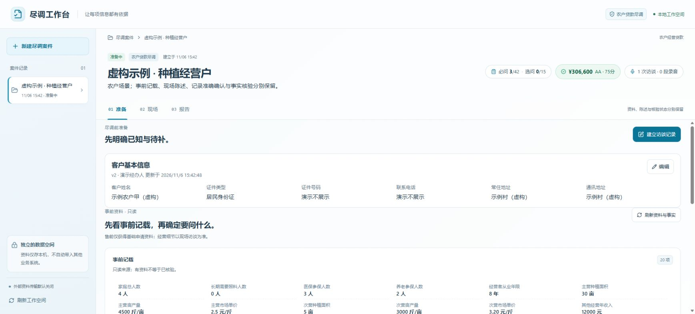
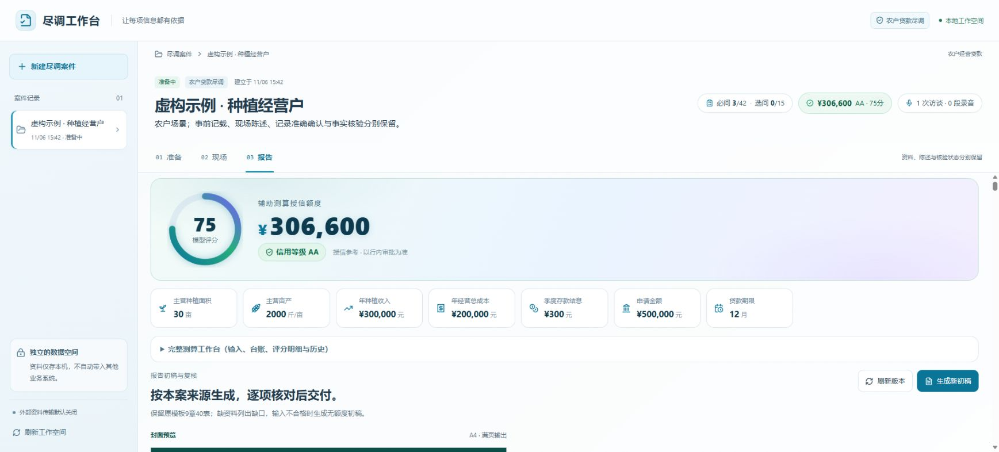
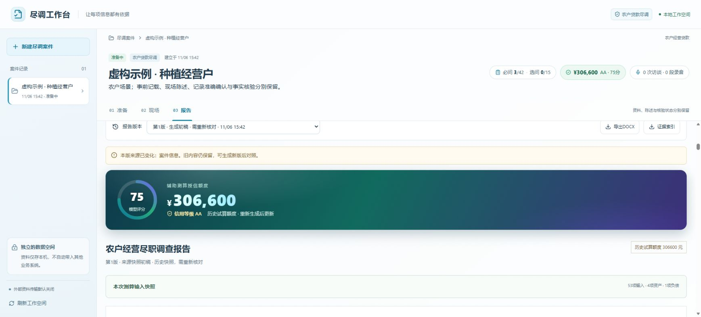

# 用一个虚构案例了解工作台

本页介绍“准备—现场—报告”的操作。截图是应用实际页面，数据来自新建的独立演示工作空间，不对应真实个人、机构或贷款业务。

## 1. 准备：先看已有资料

建立名称含“虚构示例”的案件，查看基本信息、事前记载和待补内容。证件号、电话和地址使用明确占位文字；人员使用“演示经办人”。

阅读时关注资料来自哪里、是否已经核验。事前资料中有一个数字，只表示原资料有记载。

## 2. 现场：按问题补充答案

进入“现场”，建立访谈记录，查看问卷进度与待补问题。人员可逐项录入答案；具备语音组件后，也可借助转写和模型整理候选。

例如，虚构受访者说“今年主要种植三十亩”。可以把“30亩”记录为答案，但仍需明确对应期间、种植主体与来源。确认文字记对了，并不自动证明面积已经核验。

本次演示未进行真实录音、转写或模型提取，问卷也未全部完成。

## 3. 报告：核对输入，再生成初稿

进入“报告”，展开完整测算工作台，检查输入、期间、主体、来源及核验状态。保存后运行测算：条件满足时展示辅助结果，存在缺项或冲突时按项提示。

本例为展示测算与导出界面，另行加载了完整的虚构测算输入。图中的评分、评级和金额来自该样例，不能理解为仅凭前面的几条问卷答案就能产生有效测算。事前资料与测算输入保留各自期间和口径，原报告栏目仍可能显示“待补充”。

生成初稿后，核对输入快照、来源与缺口；需要补充说明时另存人工版本，再选择相应版本导出DOCX或证据JSON。封面农田图片是场景示意。

本例调整了虚构案件名称，原报告被标记为历史快照，提示重新核对。该提示体现版本依赖发生变化，不表示旧内容已被覆盖或已经生成了新版。

## 截图说明

截图日期为2026年11月6日，展示对应源码版本的本地界面。截图只证明页面与这次合成操作的结果；语音质量、AI候选准确率、真实客户尽调质量及业务收益需要分别验证。

[返回项目首页](../README.md) · [查看开发说明](DEVELOPMENT.md)
